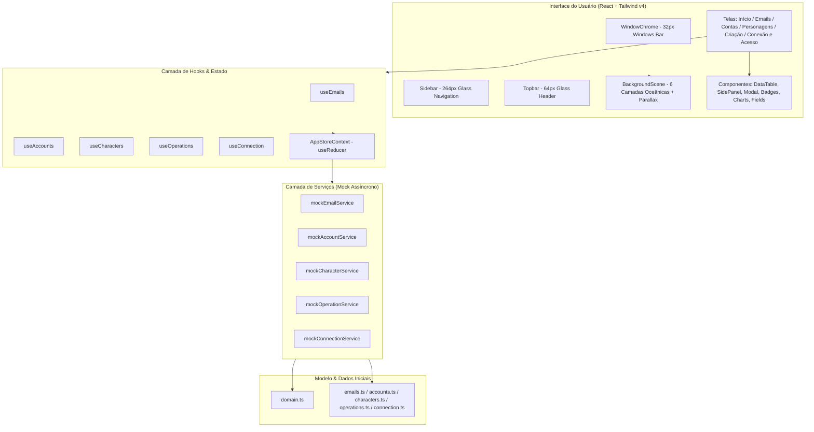

# RyujinDofus — Plano de Implementação de Design

> **For agentic workers:** REQUIRED SUB-SKILL: Use superpowers:subagent-driven-development to implement this plan task-by-task. Steps use checkbox (`- [ ]`) syntax for tracking.

**Goal:** Construir uma demonstração navegável, no navegador, de um aplicativo desktop para Windows que gerencia emails, contas Ankama e personagens de Dofus Touch no conceito visual "Profundezas", com material de vidro submerso, paleta abissal, dados fictícios e integridade relacional simulada (sem Electron e sem backend nesta fase).

**Architecture:** A aplicação é uma SPA React 18+ com TypeScript construída sobre Vite e Tailwind CSS v4. A estilização combina tokens oceânicos (`abyss`, `current`, `foam`, `biolum`), material de vidro (`glass`) com bordas gradientes e brilho especular, e superfícies de dados opacas (`surface`). Os dados de negócio residem em um store unificado (`AppStoreProvider` com `useReducer`), consumidos por uma camada de serviços assíncronos (`mock*Service` com latência de 150–400 ms) e expostos via hooks tipados (`useEmails`, `useAccounts`, `useCharacters`, `useOperations`, `useConnection`).

**Architecture Diagram:**



**Tech Stack:** React 19 / 18, TypeScript (strict), Vite, Tailwind CSS v4 (`@tailwindcss/vite`), `lucide-react`.

**Spec:** [2026-11-05-ryujindofus-design.md](file:///d:/Projetos/Ryujin_Dofus/docs/superpowers/specs/2026-11-05-ryujindofus-design.md)

---

## Global Constraints

- Alvo: Windows 10/11. Proibido convenções macOS (sem `-apple-system`, sem SF Pro, sem `⌘K`, somente `Ctrl K`).
- Textos de interface estritamente em **português do Brasil**. Símbolos de código, identificadores, tipos e arquivos em **inglês**.
- Cores, raios e espaçamentos limitados estritamente aos tokens da seção 4 da especificação:
  - Fundo: `abyss-950` (`#02050A`), `abyss-900` (`#050B14`), `abyss-850` (`#0A1626`), `abyss-800` (`#0E1D31`), `abyss-700` (`#16293F`).
  - Iluminação: `current-700` (`#17385A`), `current-600` (`#24598A`), `current-500` (`#2B6A9A`), `current-300` (`#7FB2D1`).
  - Texto e destaque: `foam-50` (`#F2F7FB`), `foam-300` (`#A9BBCB`), `foam-500` (`#8CA0B3`).
  - Acento único: `biolum-400` (`#58C4D6`), `biolum-glow` (`#0F7A87`).
  - Estados: Sucesso `#4CC38A`, Alerta `#E0A84A`, Erro `#F0706E`, Info `#6FB1F0`, Neutro `#8CA0B3`.
- Botão primário com fundo `foam-50` e texto `#0B0D12`. Nunca ciano como fundo de botão.
- Dados primeiro: tabelas e formulários usam superfícies de dados opacas (`rgba(8,19,33,.92)`), nunca vidro desfocado em superfícies de leitura intensa.
- Marcas de assinatura visual: cantos diagonais marcados em cards (superior esquerdo e inferior direito, 16×16 px, traço 1.5 px `biolum-400`).
- Respeitar `prefers-reduced-motion` e `@media (forced-colors: active)`.
- Diretório da aplicação: `d:\Projetos\Ryujin_Dofus\ryujindofus`.

---

## User Review Required

> [!IMPORTANT]
> **Escopo da Entrega:** O projeto será criado na pasta `ryujindofus/` como uma aplicação web moderna Vite + React + TypeScript + Tailwind v4 pronta para demonstração e posterior empacotamento em Electron.
> 
> **Logotipo do Dragão:** A imagem enviada pelo usuário (`media_1793917179464_6a68ebf0.png`) possui fundo preto e dragão branco. Criaremos o asset `src/assets/brand/ryujin-mark.png` com canal alfa (preto transparente) e o vetor `src/assets/brand/ryujin-mark.svg` para uso via máscara CSS (`mask: url(...) center / contain no-repeat`), preservando as proporções e garantindo que o símbolo herde dinamicamente as cores do tema.

---

## Proposed Changes

### Task 1: Scaffolding do Projeto e Configuração de Tokens

Criar a estrutura do projeto Vite React TypeScript na pasta `ryujindofus/`, instalar dependências (`lucide-react`, `tailwindcss`, `@tailwindcss/vite`), configurar `vite.config.ts`, `tsconfig.json` e definir todos os tokens e fontes no `src/styles/index.css`.

#### [NEW] `ryujindofus/package.json`
Scaffold do projeto com React, TypeScript, Vite, Tailwind CSS v4 e Lucide React.

#### [NEW] `ryujindofus/vite.config.ts`
Configuração do Vite com plugin `@tailwindcss/vite` e `@vitejs/plugin-react`.

#### [NEW] `ryujindofus/index.html`
HTML raiz configurado para Windows, título `RyujinDofus`, fonte `Segoe UI Variable`.

#### [NEW] `ryujindofus/src/styles/index.css`
Declaração `@import "tailwindcss";`, `@theme` com todas as cores (`abyss`, `current`, `foam`, `biolum`, estados), raios (`--radius-ctl: 8px`, `--radius-tag: 6px`, `--radius-card: 12px`, `--radius-glass: 14px`), fontes e utilitários base.

#### [NEW] `ryujindofus/src/assets/brand/ryujin-mark.png` & `ryujin-mark.svg`
Geração do símbolo com canal alfa a partir da imagem fornecida para aplicação de máscara CSS.

- [ ] **Step 1: Criar o projeto Vite e instalar dependências**
```bash
npm create vite@latest ryujindofus -- --template react-ts
cd ryujindofus
npm i lucide-react
npm i -D tailwindcss @tailwindcss/vite
```

- [ ] **Step 2: Configurar `vite.config.ts`**
```ts
import { defineConfig } from "vite";
import react from "@vitejs/plugin-react";
import tailwindcss from "@tailwindcss/vite";

export default defineConfig({
  plugins: [react(), tailwindcss()],
});
```

- [ ] **Step 3: Processar o logotipo para canal alfa**
Script utilitário para converter pixels pretos da imagem fornecida em transparência alfa e salvar em `src/assets/brand/ryujin-mark.png` e gerar vetor SVG `ryujin-mark.svg`.

- [ ] **Step 4: Configurar `src/styles/index.css` com os tokens exatos da especificação**
```css
@import "tailwindcss";

@theme {
  --color-abyss-950: #02050a;
  --color-abyss-900: #050b14;
  --color-abyss-850: #0a1626;
  --color-abyss-800: #0e1d31;
  --color-abyss-700: #16293f;
  --color-current-700: #17385a;
  --color-current-600: #24598a;
  --color-current-500: #2b6a9a;
  --color-current-300: #7fb2d1;
  --color-foam-50: #f2f7fb;
  --color-foam-300: #a9bbcb;
  --color-foam-500: #8ca0b3;
  --color-biolum-400: #58c4d6;
  --color-biolum-glow: #0f7a87;
  --color-ok: #4cc38a;
  --color-warn: #e0a84a;
  --color-bad: #f0706e;
  --color-info: #6fb1f0;

  --font-sans: "Segoe UI Variable Text", "Segoe UI Variable", "Segoe UI", system-ui, sans-serif;
  --font-display: "Segoe UI Variable Display", "Segoe UI Variable", "Segoe UI", system-ui, sans-serif;

  --radius-ctl: 8px;
  --radius-tag: 6px;
  --radius-card: 12px;
  --radius-glass: 14px;

  --ease-out: cubic-bezier(0.2, 0.8, 0.2, 1);
}

html { color-scheme: dark; }
body {
  font-family: var(--font-sans);
  color: var(--color-foam-50);
  font-variant-numeric: tabular-nums;
  background: linear-gradient(180deg, #0b1d33 0%, #050b14 50%, #02050a 100%) fixed;
  margin: 0;
  overflow-x: hidden;
}
```

- [ ] **Step 5: Testar build inicial**
Executar `npm run build` na pasta `ryujindofus` para assegurar que Vite + Tailwind v4 compilam perfeitamente sem erros.

---

### Task 2: Fundo em Camadas (Profundezas) e Material Vidro Submerso

Implementar o componente `BackgroundScene` com as 6 camadas do oceano (gradiente de profundidade, 3 orbes desfocados, raios de luz diagonais com máscara vertical, marca do dragão a 7% de opacidade, neve marinha em subida contínua de 90s, granulado SVG) e lógica de parallax no cursor do mouse. Configurar as classes CSS `@utility glass` e `@utility surface`.

#### [NEW] `ryujindofus/src/components/layout/BackgroundScene.tsx`
Renderiza o fundo imersivo submerso com suporte a mousemove parallax (±18 px) e suspensão sob `prefers-reduced-motion`.

#### [MODIFY] `ryujindofus/src/styles/index.css`
Adicionar os utilitários CSS `@utility glass`, `@utility surface`, cantos de assinatura visual bioluminescentes e animações suaves.

- [ ] **Step 1: Adicionar estilos de vidro e superfície no `src/styles/index.css`**
- [ ] **Step 2: Construir o `BackgroundScene.tsx`**
- [ ] **Step 3: Testar visualmente e validar ausência de travamentos no layout**

---

### Task 3: Modelo de Domínio, Dados Fictícios e Camada de Mock Services

Definir os contratos de tipo da aplicação em `src/types/domain.ts`, instanciar o conjunto de dados fictícios em `src/data/*.ts` garantindo todas as regras de integridade relacional, e criar os serviços assíncronos em `src/services/mock/`.

#### [NEW] `ryujindofus/src/types/domain.ts`
Exportar `EmailStatus`, `AccountStatus`, `CharacterStatus`, `OperationState`, `OperationType`, `EmailRecord`, `AnkamaAccount`, `Character`, `Operation`, `ConnectionSnapshot`, `Page<T>`.

#### [NEW] `ryujindofus/src/data/emails.ts`
128 emails disponíveis (`D`), além de utilizados (`U`) vinculados a contas e bloqueados (`B`), perfazendo banco de teste paginável de emails `@mailbox.test`.

#### [NEW] `ryujindofus/src/data/accounts.ts`
47 contas Ankama (`C` e `B`), cada uma associada a um email `U`.

#### [NEW] `ryujindofus/src/data/characters.ts`
Exatamente 112 personagens no total distribuídos estritamente como:
- Criados (`C`): 14
- Em progresso (`E`): 63
- Finalizados (`F`): 29
- Banidos (`B`): 6
Raças oficiais de Dofus (Iop, Cra, Eniripsa, etc.) e servidores (Draconiros, Mikhal, Brial, etc.).

#### [NEW] `ryujindofus/src/data/operations.ts`
5 operações recentes da tela Início (incluindo uma `uncertain` e uma `failed`).

#### [NEW] `ryujindofus/src/services/types.ts`
Interfaces assíncronas tipadas: `EmailService`, `AccountService`, `CharacterService`, `OperationService`, `ConnectionService`.

#### [NEW] `ryujindofus/src/services/mock/*.ts`
Implementações em mock com delay artificial (150–400 ms) simulando APIs reais.

#### [NEW] `ryujindofus/src/store/AppContext.tsx` & `reducer.ts`
Store central com `useReducer`, provendo despacho de ações para cadastro manual, banimento de conta com banimento em cascata atômico dos personagens, retirada de banimento (sem restaurar personagens), conciliação de operações e compra simulada.

- [ ] **Step 1: Criar `src/types/domain.ts`**
- [ ] **Step 2: Criar dados fictícios em `src/data/`**
- [ ] **Step 3: Implementar `src/services/mock/`**
- [ ] **Step 4: Implementar `src/store/` com regras de integridade**

---

### Task 4: Layout Base (WindowChrome, Sidebar, Topbar, SidePanel)

Implementar o shell da aplicação com barra de título estilo Windows (32 px), Sidebar em vidro (264 px) com navegação completa e status de conexão, Topbar (64 px) com busca global (`Ctrl K`) e Painel Lateral deslizante (400 px).

#### [NEW] `ryujindofus/src/components/layout/WindowChrome.tsx`
Barra de 32 px no topo com símbolo de 16 px, texto "RyujinDofus", e botões minimizar, maximizar, fechar (46 px de largura, hover `#C42B1C`).

#### [NEW] `ryujindofus/src/components/layout/Sidebar.tsx`
Sidebar de 264 px de vidro, com logotipo de 38 px, grupos exatos:
- VISÃO GERAL: Início
- EMAILS: Estoque, Importar e cadastrar, Compras, Indicadores
- CONTAS E PERSONAGENS: Contas Ankama, Personagens, Criação
- APLICATIVO: Conexão, Acesso
Pílula ativa em `foam-50` com texto escuro. Ponto pulsante verde de 2.6s com texto "API conectada". Suporte responsivo a 72 px (modo recolhido com `title` e `aria-label`).

#### [NEW] `ryujindofus/src/components/layout/Topbar.tsx`
Topbar de 64 px de vidro, título contextual, campo de busca com badge `Ctrl K` e ações contextuais.

#### [NEW] `ryujindofus/src/components/layout/SidePanel.tsx`
Painel flutuante de vidro de 400 px à direita para visualização de detalhes sem cobrir a tabela, com suporte a tecla Escape, foco gerenciado e botão de fechar.

- [ ] **Step 1: Criar `WindowChrome.tsx` com botões Windows**
- [ ] **Step 2: Criar `Sidebar.tsx` com hierarquia visual e estados ativos em Espuma**
- [ ] **Step 3: Criar `Topbar.tsx` com atalho de teclado `Ctrl K` funcional**
- [ ] **Step 4: Criar `SidePanel.tsx` com acessibilidade dialog**
- [ ] **Step 5: Integrar os componentes de layout no `App.tsx`**

---

### Task 5: Componentes Reutilizáveis de UI

Construir os blocos fundamentais de interface em `src/components/ui/` e `src/components/data/`.

#### [NEW] `ryujindofus/src/components/ui/Button.tsx`
Variantes `primary` (Espuma `#F2F7FB`), `secondary` (vidro 8% + borda 16%), `destructive` (`#F0706E`), `ghost`. Altura 38 px, raio 8 px, hover suave.

#### [NEW] `ryujindofus/src/components/ui/Fields.tsx`
`TextField`, `SelectField`, `PasswordField` (com botão de revelar/ocultar senha e texto mascarado `••••••••••` por padrão), `SearchInput` com atalho.

#### [NEW] `ryujindofus/src/components/ui/Badges.tsx`
`StatusBadge` (para entidades D/U/B, C/B, C/E/F/B: retângulo de raio 6 px com ponto colorido + texto) e `OperationPill` (para estados técnicos de operação: pílula com borda, ícone e texto, visualmente distinta).

#### [NEW] `ryujindofus/src/components/ui/Modal.tsx` & `ConfirmDialog.tsx`
Modal com barra de título, corpo, rodapé de ações, trap de foco e overlay com blur de 12 px. `ConfirmDialog` compacto para ações críticas como banimento.

#### [NEW] `ryujindofus/src/components/ui/Toast.tsx`
Provider e componente de Toast em vidro, canto inferior central, auto-dismiss em 2.4s, `role="status"`.

#### [NEW] `ryujindofus/src/components/data/DataTable.tsx` & `Pagination.tsx`
Tabela genérica com cabeçalho de 12 px em `foam-300`, linhas divisoras sutis, foco em teclado (Enter abre detalhes), hover, linha selecionada em `biolum-400` a 8%, menu de ações por linha "⋯".

#### [NEW] `ryujindofus/src/components/data/Charts.tsx`
`MetricStrip` (bloco único de vidro com 4 células separadas por divisores finos), `BarChart` (barras finas com topo 5 px suavizado, destaque do dia corrente), `SegmentedBar` (barra segmentada horizontal com raio 4 px e legenda numérica).

- [ ] **Step 1: Implementar `Button.tsx`, `Fields.tsx`, `Badges.tsx`**
- [ ] **Step 2: Implementar `Modal.tsx`, `ConfirmDialog.tsx`, `Toast.tsx`**
- [ ] **Step 3: Implementar `DataTable.tsx`, `Pagination.tsx`, `RowActionsMenu.tsx`**
- [ ] **Step 4: Implementar `Charts.tsx` (`MetricStrip`, `BarChart`, `SegmentedBar`, `Timeline`, `AttentionList`)**
- [ ] **Step 5: Testar todos os componentes contra acessibilidade (teclado, contraste, roles)**

---

### Task 6: Telas de Início e Emails

Construir a tela principal (Início) e o módulo completo de Emails (Estoque, Importar/Cadastrar, Compras simuladas e Indicadores).

#### [NEW] `ryujindofus/src/features/home/HomeScreen.tsx`
1. Título "Boa tarde, Ryujin" e subtítulo dinâmico
2. `MetricStrip`: 128 Emails disponíveis (▲ 4), 47 Contas Ankama (▲ 2), 63 Personagens em progresso (▲ 9), 29 Fluxos finalizados (▲ 3)
3. Grid 8/4:
   - Esquerda (8): gráfico de operações dos últimos 7 dias (total 158, quinta 27 em Espuma) e tabela de operações recentes (clique abre modal)
   - Direita (4): card "Requer atenção" (borda âmbar/vermelha), "Personagens por status" (barra 14/63/29/6, total 112), "Atalhos rápidos".

#### [NEW] `ryujindofus/src/features/emails/EmailsScreen.tsx`
- **Aba Estoque:** busca, filtro segmentado (Todos, Disponível, Utilizado, Bloqueado), paginação ("1–8 de 128"), menu "⋯". Clique na linha abre `SidePanel` com credencial mascarada e botão "Revelar".
- **Aba Importar e cadastrar:** formulário de cadastro manual e zona de arrastar arquivo com prévia em modal (560 px: "48 válidos · 2 duplicados · 1 inválido").
- **Aba Compras:** aviso permanente "Compra simulada: nenhum valor real será cobrado", saldo R$ 250,00, stepper de quantidade, resumo detalhado, confirmação em diálogo e injeção de emails `D` no estoque.
- **Aba Indicadores:** cards de resumo e gráfico de compras por semana.

- [ ] **Step 1: Desenvolver a tela `HomeScreen.tsx` com dados derivados do store**
- [ ] **Step 2: Desenvolver `EmailsScreen.tsx` com as 4 abas e painel lateral de credencial**
- [ ] **Step 3: Integrar modal de importação e fluxo de compra simulada**
- [ ] **Step 4: Validar cálculos, filtros e transições de estado**

---

### Task 7: Telas de Contas Ankama e Personagens

Construir as telas de gerenciamento de Contas e Personagens com regras de banimento em cascata e herança de emails.

#### [NEW] `ryujindofus/src/features/accounts/AccountsScreen.tsx`
- Tabela com login, email vinculado, status (`C` verde, `B` vermelho), data e ações
- Busca por login ou email, filtro de status, paginação
- Modal de cadastro manual: login, senha e select restrito a emails com status `D` (ao salvar, email passa para `U`)
- Painel lateral com credenciais (revelar/ocultar), email vinculado e lista de personagens da conta
- Modal de banimento de 440 px com o texto estrito exigido na especificação:
  > "Todos os personagens desta conta serão marcados como banidos. Retirar o banimento da conta não restaurará os status anteriores."
- Ação de banir: conta `B` e todos os personagens vinculados `B`.
- Ação de retirar banimento: conta `C`; personagens permanecem `B`.

#### [NEW] `ryujindofus/src/features/characters/CharactersScreen.tsx`
- Tabela com nome, conta, email herdado, raça, servidor, status (`C` Criado, `E` Em progresso, `F` Finalizado, `B` Banido), ações
- Busca e filtros por chips (conta, raça, servidor, status) com botão "Limpar filtros"
- Modal de cadastro manual de personagem: select de conta com email preenchido automaticamente como somente leitura
- Painel lateral com detalhes e select administrativo "Alterar status" (permite qualquer transição com toast).

- [ ] **Step 1: Desenvolver `AccountsScreen.tsx` e o fluxo de banimento/desbanimento**
- [ ] **Step 2: Desenvolver `CharactersScreen.tsx` com herança automática de email e filtros em chips**
- [ ] **Step 3: Validar a sincronização entre contas e personagens**

---

### Task 8: Telas de Criação, Conexão e Acesso

Implementar as telas de automação de criação e configuração do aplicativo.

#### [NEW] `ryujindofus/src/features/creation/CreationScreen.tsx`
Duas colunas de ação distintas:
- Coluna 1: **Criar conta Ankama** (select de email disponível -> Iniciar criação -> Timeline vertical de etapas -> quando solicitar código, modal para informar código -> avanço da etapa).
- Coluna 2: **Criar personagem** (select de conta, select de raça, select de servidor, aviso sobre geração aleatória, botão "Iniciar criação do personagem" separado).
- Lista inferior de operações técnicas com estados (`Aguardando`, `Executando`, `Concluída`, `Falhou`, `Resultado incerto` via `OperationPill`).
- Ações contextuais dinâmicas:
  - `Resultado incerto`: aviso "Verifique ou concilie antes de repetir." (sem botão "Repetir"), botão "Conciliar" que resolve o estado.
  - `Falhou (recuperável)`: botão "Retomar".
  - `Executando (aguardando código)`: botão "Informar código".
  - Ao finalizar criação de personagem, ele é adicionado à lista de Personagens com status `C`.

#### [NEW] `ryujindofus/src/features/connection/ConnectionScreen.tsx`
4 cartões com ponto indicador: Conexão com API (~42 ms), Banco de dados, Automação local e Data/hora da última verificação. Botão "Verificar agora" exibindo skeleton por ~800 ms antes de atualizar.

#### [NEW] `ryujindofus/src/features/access/AccessScreen.tsx`
Formulário com credencial mascarada, botão "Salvar" e feedback "Configuração salva (simulado)".

- [ ] **Step 1: Desenvolver `CreationScreen.tsx` com timelines e ações contextuais**
- [ ] **Step 2: Desenvolver `ConnectionScreen.tsx` e `AccessScreen.tsx`**
- [ ] **Step 3: Testar todos os fluxos de criação e resolução de operações**

---

### Task 9: Verificação, Acessibilidade e Critérios de Aceite

Executar checagens completas contra os 15 critérios de aceite da seção 14 da especificação e ajustar responsividade.

- [ ] **Step 1: Rodar `npm run build` e garantir compilação TypeScript com 0 erros**
- [ ] **Step 2: Validar as 6 telas e a navegação pela sidebar e topbar**
- [ ] **Step 3: Testar atalho `Ctrl K` para focar a busca**
- [ ] **Step 4: Verificar consistência das métricas no Início (112 = 14 + 63 + 29 + 6)**
- [ ] **Step 5: Validar conformidade de contrastes (mínimo 4.5:1), fontes Segoe UI Variable e ausência de convenções Apple**
- [ ] **Step 6: Testar comportamento em resoluções 1440×900, 1280×720 e 1024 px**

---

## Verification Plan

### Automated Verification
Executar no diretório `ryujindofus`:
```bash
npm run build
npm run typecheck
```

### Manual Verification Checklist
1. **Navegação:** Clicar em cada um dos itens da sidebar e verificar se a rota e o cabeçalho mudam instantaneamente.
2. **Atalho de busca:** Pressionar `Ctrl + K` em qualquer tela e confirmar que o campo de busca recebe foco.
3. **Métricas de Início:** Conferir se a faixa exibe 128, 47, 63, 29 e se o gráfico segmentado totaliza 112 (14 + 63 + 29 + 6).
4. **Painel de Credenciais em Emails:** Clicar em um email no estoque, abrir o painel lateral de 400 px, clicar em "Revelar" para mostrar a senha e "Ocultar" para mascarar novamente. Fechar o painel e reabrir para confirmar que volta mascarado.
5. **Compra Simulada:** Acessar Emails > Compras, verificar a faixa permanente de compra simulada, simular a compra de 10 emails e confirmar que os novos emails aparecem no estoque e o saldo diminui.
6. **Banimento de Conta:** Acessar Contas Ankama, clicar em "Banir conta", conferir o texto exato do modal, confirmar e verificar que a conta passa a `B` e todos os seus personagens vinculados passam a `B`. Desbanir a conta e verificar que os personagens permanecem `B`.
7. **Criação de Conta e Personagem:** Acessar Criação, executar o fluxo de criação de conta informando o código e o fluxo separado de criação de personagem. Verificar a operação com "Resultado incerto" (não permitindo repetir e orientando a conciliar).
8. **Conexão:** Acessar Conexão, clicar em "Verificar agora", observar o skeleton suave e a atualização do carimbo de data/hora.

